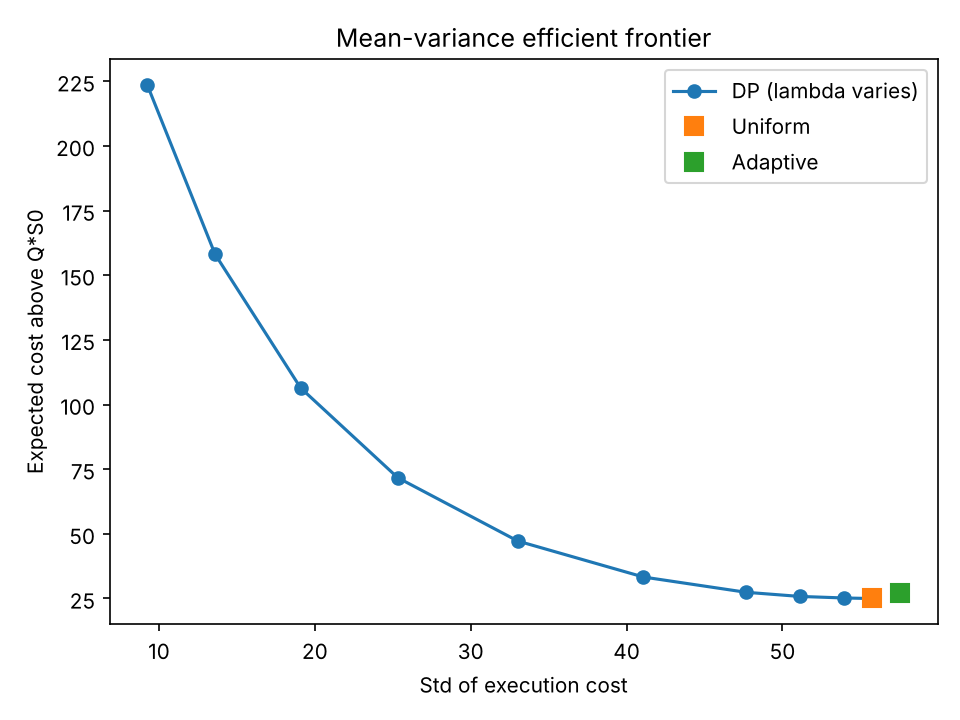
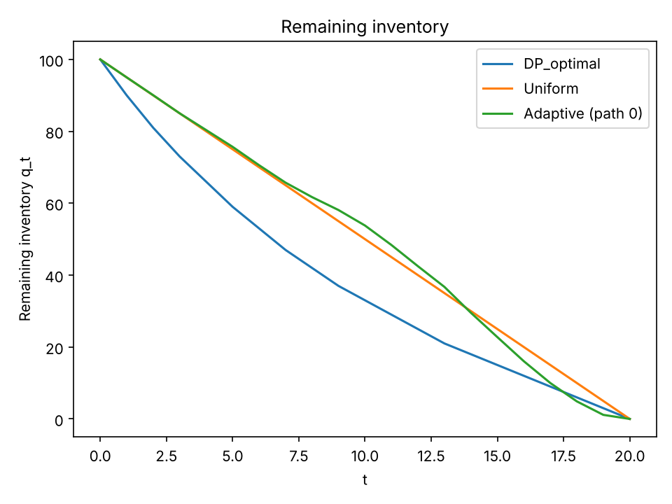

# Optimal Execution with Dynamic Programming

How should a trader split a large buy order over time? Buying fast pays **market impact**. Buying slowly leaves the position exposed to **price risk**. This project solves a discrete-time version of the Almgren–Chriss (2000) model with **dynamic programming** and compares the optimal schedule to simple benchmarks with Monte Carlo simulations.

*Course project (Operations Research), by Virgile Regnier and Alexandre Moussou.*

## Model

Buy $Q$ shares over $T$ steps of length $\Delta t$. At each step the trader buys $x_t$ shares:

$$q_{t+1} = q_t - x_t,\qquad q_0 = Q,\qquad q_T = 0,\qquad 0 \le x_t \le q_t$$

$$S_{t+1} = S_t + \sigma\sqrt{\Delta t}\,\varepsilon_t,\qquad \text{execution price } P_t = S_t + \eta\,x_t$$

The cost above the arrival price, $C - QS_0$, has:

$$\mathbb E[C] - QS_0 = \eta\sum_t x_t^2,\qquad \mathrm{Var}[C] = \sigma^2\Delta t\sum_t q_{t+1}^2$$

The trader minimises **expected cost + λ × variance**:

$$\min_{(x_t)}\; \sum_{t=0}^{T-1}\Big(\eta\,x_t^2 + \lambda\sigma^2\Delta t\,q_{t+1}^2\Big)$$

## Dynamic programming

$V(t,q)$ is the minimal remaining cost with $q$ shares left at time $t$:

$$V(t,q) = \min_{x\in\{0,\dots,q\}}\Big[\eta x^2 + \lambda\sigma^2\Delta t\,(q-x)^2 + V(t+1,\,q-x)\Big],\qquad V(T,0)=0,\; V(T,q>0)=+\infty$$

**Check.** The DP schedule matches the closed-form Almgren–Chriss solution, $q_t = Q\,\frac{\sinh(\kappa(T-t))}{\sinh(\kappa T)}$ with $\cosh\kappa = 1+\frac{\lambda\sigma^2\Delta t}{2\eta}$, up to integer rounding (max gap 0.7 share).

## Results

Parameters: $Q=100,\ T=20,\ \sigma=1,\ \eta=0.05,\ \lambda=0.01$, with 5,000 Monte Carlo paths.

| Strategy | Mean cost above Q·S₀ | Std of cost | Mean + λ·Var |
|---|---:|---:|---:|
| DP optimal | 29.8 | **44.8** | **49.9** |
| Uniform (TWAP) | **25.2** | 55.8 | 56.3 |
| Adaptive heuristic | 27.2 | 57.5 | 60.3 |

- **Uniform has the lowest expected cost**: spreading trades evenly minimises impact. The DP accepts a slightly higher expected cost to cut risk by about 20%, by buying faster at the start.
- **The adaptive heuristic does worse on both counts.** The price is a random walk, so "buy more when the price is below its average" has no predictive power and only adds variance.
- Each value of λ gives a different optimal schedule. Together they form the **efficient frontier**. Uniform is its low-risk-aversion end, and the adaptive strategy lies outside it.





*Frontier points use the exact variance formula. Uniform and Adaptive points come from Monte Carlo, hence small sampling noise.*

## Run

```bash
pip install -r requirements.txt
python optimal_execution.py     # prints results, saves figures/ 
```

## Limitations

Constant volatility, temporary impact only, no intraday volume profile. A natural extension is a participation constraint $x_t \le x_{\max}$, which the DP handles directly but the closed form does not.

## Reference

Almgren, R. & Chriss, N. (2000). *Optimal execution of portfolio transactions.* Journal of Risk, 3(2), 5–39.
